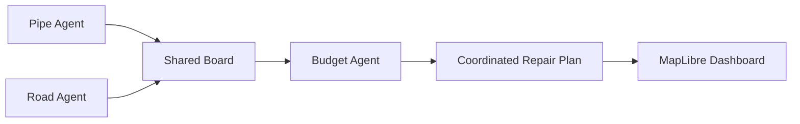

# Zhora: Agentic CIP (Capital Improvement Plan)
Problem: Lack of holistic data analysis to help cities determine infrastructure repair prioritization (including high cost, high labor, and slow process). 
Solution: Create an agentic CIP using a decentralized AI agent system. 3 AI agents: Road Agent, Pipe Agent, and Budget Agent.  

## Visual Overview



## Run It (Fresh Clone)

### Prerequisites

- Python 3.11+
- Git
- A modern web browser

### 1. Clone the Repository

```bash
git clone https://github.com/annatakai/scienceclaw.git
cd scienceclaw
```

### 2. Install Dependencies

```bash
python3 -m pip install -r requirements.txt
```

### 3. Launch Zhora

```bash
make demo
```

This command runs four infrastructure planning strategies across Boston's street network, generates the interactive dashboard, and starts a local web server.

Open **http://localhost:8000** in your browser.

### 4. Generate a Capital Improvement Plan

```bash
make cip
```

This generates the following files in `outputs/cip/`:

| File | Description |
|---|---|
| `capital_plan.html` | Printable capital improvement plan |
| `capital_plan.pdf` | PDF report |
| `decision_list.csv` | Infrastructure repair recommendations |
| `funding_table.csv` | Funding allocation breakdown |
| `report.json` | Structured planning results |

---

## Try the Multi-Agent Workflow

Zhora coordinates infrastructure maintenance through three specialized agents:

1. **Pipe Agent:** Evaluates water-main condition, failure risk, and replacement or rehabilitation options.
2. **Road Agent:** Evaluates pavement condition, road deterioration, and resurfacing priorities.
3. **Budget Agent:** Evaluates proposed projects, funding constraints, and potential savings from coordinated construction.

### Step 1. Explore Boston's Infrastructure

Open **http://localhost:8000**.

The interactive MapLibre dashboard displays Boston's street network and simulated infrastructure data.

Explore road segments to examine their conditions and proposed maintenance decisions.

### Step 2. Review Infrastructure Priorities

Open the **Decision List** tab.

Review infrastructure projects selected by Zhora, including their priority tiers, proposed actions, and funding decisions.

Select a project to locate its corresponding street segment on the map.

Use the year filter to explore the capital improvement schedule.

### Step 3. Compare Planning Strategies

Zhora evaluates four infrastructure planning approaches:

| Strategy | Description |
|---|---|
| **Isolated** | Road and pipe departments independently prioritize projects using separate budgets |
| **Pooled** | Departments share a common budget without direct agent negotiation |
| **Coordinated** | Agents exchange proposals through a shared board and coordinate funding decisions |
| **Centralized** | A single planner evaluates infrastructure projects using combined information |

Run the comparison experiment:

```bash
make compare
```

This experiment evaluates the strategies across 30 paired simulation seeds on an 800-segment study area.

Compare total costs, project selection, and the effects of budget pooling and inter-agent coordination.

### Step 4. Explore the Capital Improvement Plan

Generate the report:

```bash
make cip
```

The resulting plan includes recommended infrastructure projects, budget allocations, funding sources, and comparisons against isolated planning.

The dashboard also supports exporting the decision list and capital plan.

---

## Run Experiments

Zhora includes experiments for evaluating the performance and robustness of its planning strategies.

| Experiment | Command | Purpose |
|---|---|---|
| Strategy comparison | `make compare` | Compare isolated, pooled, coordinated, and centralized planning |
| Full-network comparison | `make compare-full` | Evaluate strategies across the larger Boston network |
| Baseline evaluation | `make baselines` | Compare against age-first, risk-first, and centralized optimization approaches |
| Sensitivity analysis | `make sensitivity` | Examine how planning results change under different assumptions |
| Capital improvement plan | `make cip` | Generate planning reports and funding recommendations |
| Agent scoring | `make score` | Evaluate synthetic pipe and road condition data |

All experiments use simulated infrastructure conditions, failure outcomes, and costs. Boston street geometry is based on real geospatial data.

---

## Tests

Run the test suite:

```bash
make test
```

The tests cover the project's simulation and planning components, including agent decisions and mocked Claude interactions.

For the optional Claude-driven agent comparison:

```bash
python3 -m experiments.compare_llm
```

This requires the optional Anthropic dependency and API access.

---

## Data and Simulation

Zhora combines real Boston street geometry with simulated infrastructure asset data.

**Real-world geographic data:**
- Analyze Boston Street Segments
- MassDOT Road Inventory
- Boston neighborhood boundaries

**Simulated infrastructure data:**
- Pipe age, material, and condition
- Pavement condition
- Water-main failures
- Repair and replacement costs
- Maintenance budgets

The simulation covers approximately **15,176 street segments across 839.2 miles** of Boston's street network.

To regenerate synthetic asset datasets:

```bash
python3 -m sim.export_city
```

The generated data supports reproducible experiments without requiring access to confidential municipal infrastructure records.

---

## Limitations

Zhora is a research prototype, not an operational municipal planning system.

Infrastructure conditions, costs, and failure outcomes are simulated. Although the simulation incorporates a Boston water-main break-rate calibration, the current results do not establish real-world cost savings.

Under the calibrated scenario, the current experiments produce no shared excavations. The measured improvement over isolated planning primarily reflects pooled budgeting, rather than demonstrated excavation coordination.

Future development will focus on integrating real infrastructure asset data, improving failure prediction, and evaluating coordinated excavation opportunities.
